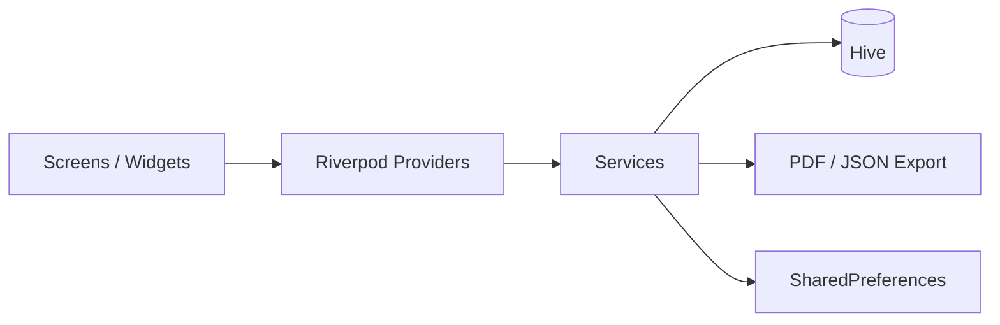

# Hesabatna (حساباتنا)

Offline-first Flutter app for tracking shared expenses and settling debts among groups of people. Supports English and Arabic (RTL).

| | |
|---|---|
| **Version** | 1.0.0+1 |
| **Dart SDK** | ^3.9.2 |
| **Platforms** | Android, iOS, Web, Windows, macOS, Linux |
| **Data storage** | Local only (Hive) – no network required |

## Features

- **Groups**: create groups with a name and currency; add, edit and delete members.
- **Expenses**: record description, amount, payer, date and notes.
  - Equal split among selected beneficiaries.
  - Custom split with per-member amounts.
- **Payments (settlements)**: record payments between members with date and notes.
- **Balances**: net balance per member, pairwise balances, and suggested minimum settlements.
- **Transaction details**: bottom sheet with the full breakdown of any transaction.
- **Export**: PDF report (shareable/printable) and JSON backup.
- **Localization**: English and Arabic, RTL layout, persisted language preference.
- **UI**: modern blue theme with gradient cards.

## Tech Stack

| Area | Package |
|---|---|
| State management | `flutter_riverpod` |
| Local database | `hive`, `hive_flutter`, `hive_generator`, `build_runner` |
| PDF / printing | `pdf`, `printing` |
| Localization | `flutter_localizations`, `intl` |
| Preferences | `shared_preferences` |
| Files | `path_provider`, `file_picker` |
| IDs | `uuid` |

## Getting Started

```bash
# 1. Install dependencies
flutter pub get

# 2. Generate Hive adapters
dart run build_runner build --delete-conflicting-outputs

# 3. Generate localization files (also runs automatically on build)
flutter gen-l10n

# 4. Run
flutter run
```

Other commands:

```bash
flutter analyze        # static analysis
flutter test           # run tests
flutter build apk      # Android release build
```

## Project Structure

```
lib/
├── main.dart                 # App entry point
├── config/                   # App configuration (theme, constants)
├── l10n/                     # ARB files (en, ar) and generated localizations
├── models/                   # Hive models: Group, Member, Expense, ExpenseShare, Payment
├── providers/                # Riverpod providers
│   ├── groups_provider.dart
│   ├── expenses_provider.dart
│   ├── payments_provider.dart
│   └── balance_provider.dart
├── services/
│   ├── database_service.dart     # Hive initialization and boxes
│   ├── balance_service.dart      # Balance and settlement calculations
│   ├── export_service.dart       # PDF / JSON export
│   └── preferences_service.dart  # Language and settings persistence
├── screens/
│   ├── home_screen.dart
│   ├── groups_list_screen.dart
│   ├── group_detail_screen.dart
│   ├── add_expense_screen.dart
│   ├── add_payment_screen.dart
│   └── profile_screen.dart
├── utils/
│   └── transaction_details_helper.dart
└── widgets/                  # Reusable UI (dialogs, tabs, cards, bottom sheets)
```

## Data Models

| Model | Purpose |
|---|---|
| `Group` | Name, currency, creation date |
| `Member` | Person belonging to a group |
| `Expense` | Payment made by one member for the group |
| `ExpenseShare` | Amount each beneficiary owes for an expense |
| `Payment` | Settlement from one member to another |

## Architecture



- UI reads state from providers and triggers actions through them.
- Services hold the logic (database access, balance calculation, export).
- Hive models use generated `*.g.dart` adapters; do not edit these by hand.

## Balance Logic

1. Each expense creates shares: every beneficiary owes the payer their share.
2. Each payment reduces the debt from payer to receiver.
3. Net balance = total owed to a member − total the member owes.
4. Suggested settlements are computed by matching debtors with creditors to minimize the number of transactions.

Example: Ahmed pays 100 for dinner split equally among Ahmed, Sara and Ali. Sara and Ali each owe Ahmed 33.33. If Sara then pays Ahmed 30, Sara owes 3.33 and Ahmed is owed 36.66 in total.

See [PAYMENT_LOGIC.md](PAYMENT_LOGIC.md) for details.

## Localization

- ARB files live in `lib/l10n/` (`app_en.arb`, `app_ar.arb`); configuration is in [l10n.yaml](l10n.yaml).
- To add a string: add the key to both ARB files, run `flutter gen-l10n`, then use `AppLocalizations.of(context)`.
- See [LOCALIZATION_GUIDE.md](LOCALIZATION_GUIDE.md).

## Related Documentation

| File | Content |
|---|---|
| [README.md](README.md) | General readme and usage guide |
| [SETUP.md](SETUP.md) | Environment setup |
| [QUICK_REFERENCE.md](QUICK_REFERENCE.md) | Quick reference |
| [IMPLEMENTATION_SUMMARY.md](IMPLEMENTATION_SUMMARY.md) | Implementation summary |
| [PAYMENT_LOGIC.md](PAYMENT_LOGIC.md) | Payment and settlement logic |
| [TRANSACTION_DETAILS_FEATURE.md](TRANSACTION_DETAILS_FEATURE.md) | Transaction details feature |
| [UI_UX_DOCUMENTATION.md](UI_UX_DOCUMENTATION.md) | UI/UX documentation |
| [MODERN_BLUE_THEME_GUIDE.md](MODERN_BLUE_THEME_GUIDE.md) | Theme guide |
| [LOCALIZATION_GUIDE.md](LOCALIZATION_GUIDE.md) | Localization guide |
| [ARABIC_LOCALIZATION_SUMMARY.md](ARABIC_LOCALIZATION_SUMMARY.md) | Arabic localization summary |
| [DEBUG_FEATURES.md](DEBUG_FEATURES.md) | Debug features |

## Roadmap

- Voice expense entry (Gemini API)
- Multi-currency with conversion
- Cloud sync
- Analytics and charts
- Settlement reminders via messaging

## License

Private project for expense tracking among friends and groups.
